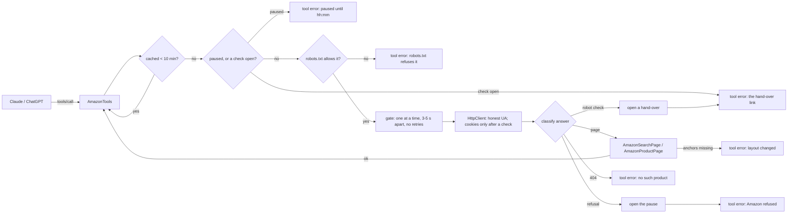

# Amazon service: design

Issue: #121. Status: approved by the owner on 2026-11-22 ("N4: Approve"), with D1, D2, D2b
and D4-D7 decided the same day.
D3, a browser for script checks, is open but not needed to start (section 2). Nothing is
built yet.

## 1. What we are building

An `/amazon/mcp` service, so a person in Claude or ChatGPT can search Amazon and get, for
each product, what they need to choose one: price, star rating, number of ratings, what
customers say, the description and the details.

It has two tools:

| Tool | Input | Returns |
|---|---|---|
| `amazon_search` | a query; a sort (`relevance`, `price` or `rating`); 1 to 10 pages; price range, minimum stars (never below 3), minimum number of ratings, and any of Amazon's own filters for that search | Up to 10 pages of results: ads dropped, duplicates merged, sorted. For each product: ASIN, title, link, image, price, list and unit price, stars, number of ratings, weighted rating, "bought in past month", badges, delivery text. Also Amazon's filter menu for the search, for the next call |
| `amazon_get_product` | an ASIN or an Amazon product link | Everything on the product page that helps a person choose (section 4.2): prices and deal, availability and seller, stars, number of ratings, the star breakdown, Amazon's "Customers say" summary with each aspect's positive and negative counts and quotes, feature bullets, description, details table, Best Sellers Rank, categories, variations, images and returns |

### 1.1 How we got here

- **#28 (2026-11-17/18)** recorded Amazon in a browser. Search results (`/s?k=`) and product
  pages (`/dp/{asin}`) came back only as whole HTML pages. There was no data call for
  web-api-discovery to wrap. The issue was closed, and Amazon waited for HTML support (#69).
- **#59** proposed a generic browser reader, with Amazon as its first use.
- **#96 (2026-11-20)** set the browser rule: no provider uses a browser by default, and any
  browser use needs the owner's approval for that provider and that use case.

### 1.2 The finding that shapes this design (2026-11-22)

#28 assumed that Amazon would refuse plain requests, because its firewall checks the browser.
That was never tested. Four requests from DAKAR, spaced a few seconds apart, tested it. Each
used an honest user agent, with no cookies, no browser headers and no browser:

| Request | User agent | Answer |
|---|---|---|
| `GET /robots.txt` | `Multiplex/0.1 (personal research service)` | `200` |
| `GET /s?k=usb+c+charging+cable` | the same | `200`, 1.6 MB of HTML (291 KB compressed), 22 results. The markup matches the page the browser got in #28 (same `data-component-type`, `data-cy` and `aria-label` hooks) |
| `GET /dp/B088NRLMPV` | the same | `200`, 2.8 MB of HTML (476 KB compressed). Title, price, list price, unit price, 4.7 stars, 91,951 ratings, star breakdown, "Customers say" (eight aspects with counts and quotes), 19 images, details table, Best Sellers Rank |
| `GET /s?k=usb+c+charging+cable` | `Multiplex-Amazon/0.1`, the identity this design ships (section 3) | `200`, 1.3 MB of HTML, 22 results, no robot check |
| `GET /s?k=...&rh=p_36:500-1000,p_72:1248879011` | the same | `200`; all 16 unpaid results between $5.00 and $9.99, and 4.5 stars or more (4.1) |
| `GET /s?k=...&low-price=5&high-price=10` | the same | `200`; the same range honoured |
| `GET /s?k=...&rh=p_36:1500-,p_123:3271\|234478` | the same | `200`; a minimum alone is accepted but applied loosely (4 of 16 under $15); "Anker or Amazon Basics" gave only Anker |
| `GET /s?k=...&rh=p_123:3271\|234478` | the same | `200`; only Anker (16 of 16), so `\|` does not mean "either" (4.1) |
| an image from `m.media-amazon.com` | the same | `200`, a 25 KB JPEG; that host's robots.txt has no `*` group |
| `GET /s?k=...&s=price-asc-rank` and `&s=review-rank` | the same | `200`; Amazon's own price and rating orders, which shaped the `sort` recipes (4.1) |
| `GET /s?k=...&s=price-asc-rank&rh=p_72:1248879011` | the same | `200`; the `price` recipe: all 16 unpaid results rated 4.1 to 5.0, and 12 with at least 20 ratings (4.1) |
| `GET /s?k=...&page=1` to `page=10`, 2 to 3 seconds apart | the same | all `200`, 16 results each, no robot check, about 43 seconds in all (5.2) |

So **Amazon needs no browser to read**. The service reads Amazon's pages over plain HTTP and
parses the HTML, and #59 loses its first use.

That reverses part of #28's conclusion. One quiet day from one home IP is not a guarantee.
The design therefore treats a block as something that will happen (section 5.3). When the
block is Amazon's "type the characters" robot check, a person answers it through a link to
a Multiplex page, still with no browser (section 5.7). Only a check that needs a script run
would need a browser, and that is D3.

## 2. The owner's decisions

**D1. Go ahead at all, given Amazon's terms. Decided 2026-11-22: go ahead.** The owner's
answer:

> I'm human checks are okay, we just pass back a link to AI, the users clicks the links and
> does the captcha, before continuing

The hand-over this asks for is section 5.7. What the owner weighed follows.

Amazon's Conditions of Use forbid automated access. The owner knew this when choosing to go
ahead in #28. Two newer facts bear on it:

- **robots.txt.** Amazon's `robots.txt` allows `/s` and `/dp/` for `User-agent: *`. However,
  it blocks the user-facing AI fetchers by name with `Disallow: /`: `Claude-User`,
  `Perplexity-User`, `GoogleAgent-Shopping`, `GoogleAgent-Mariner`, `CopilotNative` and
  others. A Multiplex service that fetches pages for a person talking to Claude belongs to
  that class, even though it does not go by any of those names.
- **The Perplexity lawsuit.** In November 2025 Amazon sued Perplexity over its Comet shopping
  agent. The complaint centres on the agent passing itself off as Google Chrome, getting past
  a block Amazon had put up, and acting inside customers' signed-in accounts. Sources:
  [Bloomberg](https://www.bloomberg.com/news/articles/2025-11-04/amazon-demands-perplexity-stop-ai-agent-from-making-purchases),
  [Retail Dive](https://www.retaildive.com/news/amazon-sues-perplexity-ai-shopping-agents/804871/),
  and the [complaint](https://storage.courtlistener.com/recap/gov.uscourts.cand.459191/gov.uscourts.cand.459191.1.0_1.pdf).
  How the case has gone since was not checked.

This design is the most cautious form of the idea:

- it names itself honestly and obeys any robots.txt rule that names it (5.1), so Amazon can
  turn it away with one line;
- it stays signed out and only reads, with no account, cart or purchase;
- it is paced and personal, behind Multiplex's own sign-in allowlist;
- it never answers a robot check itself, and stops at any other block.

Said plainly, the hand-over the owner chose (5.7) **is a way past Amazon's robot check**. A
person answers the check, but afterwards Multiplex's automated requests carry on in the
session that passed. That is close to what Amazon objects to, so it belongs in this
decision.

It still breaks the Conditions of Use.

There is one more risk, and it falls on the owner. DAKAR and the Linux host share the
household's public IP address. If Amazon flags that address, the owner's own shopping can
start to hit "I am human" checks too. The owner accepted this in the answer above.

**D2. Reviews stay a summary, to start. Decided 2026-11-22.** The owner: "If we can skip the
signin to start, we should."

Signed out, Amazon's product page says "Sign in to see customer reviews". It shows no review
text, only the stars, the count, the breakdown and the AI "Customers say" block. That block
has each aspect's counts and a few short quotes from reviews. Individual reviews need an
Amazon sign-in, so this design returns the summary only. An Amazon sign-in for full
reviews can come later (section 8).

**D2b. Pages and images, not with a browser. Decided 2026-11-22.** The owner: "my thinking is
we download the HTML and product images... but not with a browser." The service reads pages
and fetches the main product image over plain HTTP (4.2, 5.1), and the robot-check hand-over
uses no browser either (5.7). #59's browser reader is not needed for Amazon.

**D4. Filters in the first build. Decided 2026-11-22.** The owner: "first build... this is
key functionality." See 4.1: price range, minimum stars and Amazon's own per-search
filters, all tested live, plus a minimum number of ratings.

**D5. Several pages per call. Decided 2026-11-22.** The owner: "several I'd say. one key
would be trying to determine the sort order." Later the owner asked for 10 pages, tested
first: "Can we do 10? Perhaps test to verify that would work before building." The test
passed (1.2). `amazon_search` now reads up to 10 pages in one call, and sorts everything it
read (D7).

**D6. Sponsored results dropped. Decided 2026-11-22.** The owner: "we should filter out
sponsored items by default... if not entirely." They are dropped entirely, with no input to
keep them. The answer says how many were dropped.

**D7. Sort by price or rating, with relevance as a bonus, and never below 3 stars. Decided
2026-11-22.** The owner: "I suspect we are going to want to be able to support 2 sort
orders: namly price and rating. A bonus would be to support relevance (according to
Amazon)." Then: "use whatever the standard PowerShell term is. I assume changing this is
an enum. I assume items could be sorted using PS Item-OrderBy (or whatever the PS command
is) as well. I'm inclined to have a min rating of 3 regardless."

What this means in the design (4.1):
- The input is `sort`, after PowerShell's `Sort-Object`.
- It is an enum: `relevance`, `price`, `rating`.
- Every value a person might sort on is a plain number on each result, so
  `Sort-Object price` works directly.
- `minRating` is never below 3.

**D3. A browser for script checks? Open; not needed to start.** Amazon has two kinds of
robot check:

- **The "type the characters" check.** It is a picture and a form, and a person can answer
  it through Multiplex with no browser (5.7). Amazon is known to serve this kind to clients
  that run no scripts, such as this service, though this service has not met one yet.
- **The "I am human" checkbox or puzzle** (#28 met it in a real browser). It needs Amazon's
  script to run in a browser.

This service runs no scripts, so it should only ever meet the first kind. If it meets the
second, the service pauses and says so (5.3). Answering the second kind would need a browser
on the server, mirrored to the person the way TripIt's sign-in is, and the #96 rule needs the
owner's approval for that provider and use case. Recommendation: don't approve it now. If
script checks ever appear in the log, decide then.

## 3. Boundaries (carried from #28 and #59, plus #96)

- No browser: plain HTTP for pages, images and the robot-check hand-over (D2b). A browser
  would come in only for script checks, and only with the owner's #96 approval (D3).
- An honest identity:
  - The user agent is `Multiplex-Amazon/<version>`.
  - No `sec-ch-ua*` client hints and no copied browser headers.
  - No fingerprint tricks and no rotating addresses or proxies.
  - A test enforces this (T3.1).
  - No contact URL in the user agent, because it would name the owner to Amazon. Adding one
    is the owner's choice.
- It obeys robots.txt: the `*` rules, and any group that names `Multiplex-Amazon` or
  `Multiplex` (5.1).
- Nothing in Multiplex answers or solves a robot check. A person answers it, through the
  link in 5.7. Until then, every call fails at once with that link and contacts nothing.
- HTTPS only. Every request to Amazon is `https://`, and an `http://` address or a
  redirect to one is refused (T3.40). Multiplex itself, the hand-over page included, is
  served over HTTPS through its tunnel.
- Every address read from Amazon's pages is checked before it is used. The check form must
  post to `https://www.amazon.com/errors/validateCaptcha`. Images must come from a named
  Amazon image host (`m.media-amazon.com`, `images-na.ssl-images-amazon.com`). Anything
  else is refused and counted as a changed layout.
- Signed out, read only. No sign-in, account, cart, wish list, address or purchase pages.
  The client follows no redirect outside `/s`, `/dp/` and `/gp/product/`.
- Paced: one request in flight to Amazon from the whole host, pages, images and all.
  Requests are 3 to 5 seconds apart, except consecutive pages of one search, which are 2 to
  3 seconds apart (5.2).
- `amazon.com` only, in US dollars.

## 4. The tools

### 4.1 `amazon_search`

Search is the heart of the service. Four owner decisions (D4-D7) shape it:
- Amazon's own filters are in the first build.
- One call can read up to 10 pages and sort them by price or rating.
- Sponsored results are dropped.
- No product rated below 3 stars is ever returned.

| Input | Type | Default | Notes |
|---|---|---|---|
| `query` | string, required | | What a person would type into Amazon's search box |
| `sort` | enum: `relevance`, `price`, `rating` | `relevance` | The order, named after PowerShell's `Sort-Object` (D7). Each value is a recipe, below. In code it is a C# enum, `AmazonSort` |
| `pages` | int, 1-10 | 1 | How many result pages to read in this call, from `startPage` on. Pages are 2 to 3 seconds apart, so 10 pages take about 40 seconds (tested, 1.2). The search stops early at Amazon's last page (no "Next" link), at page 20 (`startPage` 15 with `pages` 10 reads 15 to 20), or at the call's 50-second deadline. With other calls in between, a 10-page search often ends at 8 or 9 pages, with `nextPage` saying where to carry on (5.2) |
| `startPage` | int, 1-20 | 1 | Where to start. Amazon offered 20 pages for the test search, and fewer when filtered. `nextPage` in the answer says where to carry on, or is `null` at the end |
| `minPrice`, `maxPrice` | number, US dollars, 0-100,000 | none | Sent to Amazon as `rh=p_36:<min cents>-<max cents>`, the form Amazon's own price links use. Cents are the dollars times 100, rounded to the nearest cent. One bound alone gives `p_36:1500-` or `p_36:-1000`, both seen working. A minimum above the maximum is an input error. Amazon applies this loosely: in a minimum-only test, 4 of 16 results were under the minimum. So every result is also checked, and one with no price is dropped |
| `minRating` | number, 3-5 | 3; 4 for `price` | No rated product below 3 stars is ever returned (D7). Raise it to ask for more. At 4 or more, it is also sent to Amazon as `p_72:1248879011` ("4 Stars & Up", the only star filter Amazon offered). Every result is checked. **Unrated products** are kept only when the caller gave no `minRating` and the sort is `relevance`, with `rating` `null`. Any `minRating` the caller gives drops them, and `price` and `rating` drop them anyway (they need at least 20 ratings) |
| `minRatingsCount` | int | per `sort`, below | Our own filter: drops products with fewer ratings than this. Amazon has no such filter |
| `filters` | list of codes, at most 10 | none | Amazon's filters for this search, taken from `availableFilters` in an earlier answer: brand, length, connector type, condition, delivery day and so on (`p_123:3271` is Anker). The rules are below the table |

Request, once per page: `GET https://www.amazon.com/s?k=<query>&s=<amazon order>&page=<n>&rh=<codes>`.
Every filter goes in the one `rh=`, comma-separated, as Amazon's own links do. The `rh`
value is URL-encoded as a whole.

**Rules for `filters`.** A code goes into Amazon's address, so it is checked strictly:
- It must match `^p_[A-Za-z0-9_-]{1,64}:[A-Za-z0-9]{1,32}$`. Group names in the wild carry
  hyphens and digits (`p_n_g-101014941094111`, `p_n_condition-type`). Values are digits,
  or letters and digits for sellers (`p_6:A30XRGG45X0IFD`). That pattern lets no `,`, `&`,
  `%`, `|` or space through.
- `p_36` and `p_72` are refused here, because `minPrice`, `maxPrice` and `minRating` set
  them.
- **One code per group.** Amazon offers no "either" within a group. `p_123:3271|234478`
  (Anker or Amazon Basics) returned only Anker on 2026-11-22, and two codes in one group
  joined by a comma would mean "both at once". A second code from the same group is an
  input error that says so. To compare brands, the AI runs one search per brand.

A refused input is a tool error naming the code, and no request is made.

**Filters were tested live on 2026-11-22:**
- `rh=p_36:500-1000,p_72:1248879011` returned 16 unpaid results, all between $5.00 and
  $9.99 and all 4.5 stars or more.
- `low-price=5&high-price=10` (Amazon's price slider) returned the same. The design uses
  `p_36`, because it combines with the other codes in one `rh=`.
- The one result under 4.5 stars on that page was an ad, because ads ignore filters.
  That is one more reason to drop them, and to check prices and stars ourselves.

**The three sort orders.** Each sort asks Amazon for a set of products, then orders
what came back across every page read. Neither half alone is enough. On 2026-11-22 Amazon's
own sorts for "usb c charging cable" returned:

| Amazon's order | First unpaid results |
|---|---|
| Price: low to high (`price-asc-rank`) | Junk: $0.01 and $0.99 listings, 13 of 16 with no rating at all, the rest with 1 to 5 ratings |
| Avg. customer review (`review-rank`) | Good products, badly weighted: 5.0 stars from 45 ratings above 4.8 from 35,896 |
| Featured (`relevanceblender`) | Well-known, on-topic products |

So:

| `sort` | Asks Amazon for | Then | Minimums it adds |
|---|---|---|---|
| `relevance` | `s=relevanceblender` (Featured) | Amazon's order, `amazonRank` | none beyond the 3-star floor |
| `price` | `s=price-asc-rank` | cheapest first | `minRating` 4, sent to Amazon as "4 Stars & Up", and at least 20 ratings, which cuts the $0.01 junk |
| `rating` | `s=review-rank` | highest `weightedRating` first | at least 20 ratings |

- **The `price` recipe was tested live** (`s=price-asc-rank` with "4 Stars & Up"). All 16
  unpaid results were rated 4.1 to 5.0. 12 of the 16 also had at least 20 ratings: real
  cables at $0.82 to $1.15, not the unrated $0.01 listings. Amazon's own price order was not
  strict ($0.82 came after $1.10), which is why the service sorts by price itself. Cheapest
  first really is cheapest, so the tool description tells the AI to pair `price` with a
  `minPrice`, or with filters, when the person wants something better than the cheapest.
- A `minRating` or `minRatingsCount` given by the caller replaces the minimum the sort
  adds. A `price` search with `minRating` 3 sends no "4 Stars & Up".
- The answer's `appliedMinimums` gives the values actually used, for example
  `{ "minRating": 4, "minRatingsCount": 20 }` for a default `price` search, so nothing is
  hidden.
- The 20 is a constant in code, not a setting.
- Amazon's newest, best-sellers and price-high-to-low orders are left out. They can come
  back if wanted.

**`weightedRating`** is on every rated result, and the `rating` sort uses it. It is
(n x R + m x C) / (n + m):
- R is the product's stars and n its rating count;
- C is 3, the lowest rating the service ever returns;
- m is 100.

Put plainly: every product starts as if 100 people had rated it 3 stars, and its real
ratings are added to those. A 4.8-star product with 12 ratings ranks below a 4.7-star
product with 90,000, which is what most people mean by "best rated". A product's score
depends only on its own stars and count, so it is the same in every answer.

C was first the average stars of the results in the answer, given as `ratingBaseline`.
Section 13 says why that was dropped.

**Ties.** For `price`, ties go to the higher `weightedRating`, then `amazonRank`. For
`rating`, ties go to the higher count, then the higher stars, then `amazonRank`. Results
missing the value sorted on go last, in `amazonRank` order.

**Sorting again on the caller's side.** Every number a person might sort on is a plain
field on each result: `price`, `listPrice`, `rating`, `ratingsCount`, `weightedRating`,
`boughtInPastMonth` (the lower bound of Amazon's label: "500+" is 500, "10K+" is 10,000,
"1M+" is 1,000,000) and `amazonRank`. The currency is given once, at the top. So any client
can re-order the results without asking Amazon again: the AI, or PowerShell with
`$r.results | Sort-Object price` or `Sort-Object weightedRating -Descending`. Pages are also
cached for 10 minutes (5.5), so calling again with another `sort` over pages already read
costs no request when Amazon's order is the same. `price` and `rating` ask Amazon for
different products, so switching between them does fetch.

**What every search does to the results:**
- **Sponsored results are dropped** (D6), with their count in `sponsoredRemoved`. On the
  test pages, 6 of 22 were ads. When an advertised product also appears unpaid, the unpaid
  entry stays.
- **Duplicates across pages are dropped.** Amazon repeats products; each ASIN appears once,
  where it first appeared.
- **Duplicates across pages matter.** In the 10-page test, 15 ASINs appeared on more than
  one page.
- **Our own filters** (`minPrice`, `maxPrice`, `minRating`, `minRatingsCount`) drop
  results. Their count is in `filteredOut`. They can drop every result. `results` is then
  empty, and `note` says why: "All 16 results had fewer than 500 ratings."

Output (field names final; values from the 2026-11-22 pages):

```json
{
  "query": "usb c charging cable",
  "sort": "rating",
  "appliedMinimums": { "minRating": 3, "minRatingsCount": 20 },
  "currency": "USD",
  "pagesRead": [1, 2, 3],
  "nextPage": 4,
  "totalResults": "over 60,000",
  "sponsoredRemoved": 17,
  "filteredOut": 3,
  "results": [
    {
      "amazonRank": 3,
      "asin": "B088NRLMPV",
      "title": "Anker USB C to USB C Cable, 60W Fast Charging Cable (2-Pack, 6 ft, Black)",
      "url": "https://www.amazon.com/dp/B088NRLMPV",
      "imageUrl": "https://m.media-amazon.com/images/I/71k0d1eTetL._AC_UY218_.jpg",
      "price": 7.99,
      "listPrice": null,
      "unitPrice": "$4.00/count",
      "rating": 4.7,
      "ratingsCount": 91951,
      "weightedRating": 4.698,
      "boughtInPastMonth": 10000,
      "boughtInPastMonthText": "10K+",
      "badges": ["Black Friday Deal"],
      "delivery": "FREE delivery Fri, Nov 27 on $35 of items shipped by Amazon"
    }
  ],
  "availableFilters": [
    { "name": "Brands", "options": [ { "label": "Anker", "code": "p_123:3271" }, { "label": "Amazon Basics", "code": "p_123:234478" } ] },
    { "name": "Length", "options": [ { "label": "5 to 5.9 ft", "code": "p_n_g-101014941094111:119746484011" } ] },
    { "name": "Condition", "options": [ { "label": "New", "code": "p_n_condition-type:2224371011" } ] }
  ],
  "warnings": [],
  "sources": ["https://www.amazon.com/s?k=usb+c+charging+cable&page=1"],
  "fetchedAt": "2026-11-22T23:52:47Z"
}
```

- **`amazonRank`** is the product's place in Amazon's own order, counting across pages
  without the ads: page 2's first unpaid result follows page 1's last. It shows what the
  re-ranking changed.
- **`availableFilters`** is Amazon's filter menu for this search, read from the first page
  (each option is an `li` whose `id` is `p_123/3271`; the code is `p_123:3271`). The AI
  passes chosen codes back in `filters`. That gives every category's own filters without
  this service knowing or guessing a single code. It is trimmed to 10 options per group and
  15 groups, because each one costs the AI context. Price and stars are left out, because
  they have their own inputs.
- **A failure ends the search, but keeps what was read.** The causes are:
  - a robot check, the pause, or an open hand-over;
  - a cap, the queue limit, or the call's deadline;
  - robots.txt refusing the page;
  - a `429` or `5xx` after its retry;
  - a changed layout.

  On the first page, the failure is the tool error it would be for one page. On a later
  page:
  - the answer holds the pages already read;
  - a warning names the page that failed and why;
  - `nextPage` points at that page.

  If the cause was a robot check, the answer also carries
  `"handOver": { "url": ..., "expiresAt": ... }` at the top. The tool description tells the
  AI to give that link to the person, so it is not buried in a warning.
- **`url` is built from the ASIN.** Organic links carry tracking (and ad links, before they
  are dropped, go through Amazon's `/sspa/click` redirect). `https://www.amazon.com/dp/{asin}`
  is stable.
- **A field that can't be read exactly is `null`, never a guess.** One example: `ratingsCount`
  comes from the exact `aria-label` ("91,951 ratings"), never from the shortened "(91.9K)".

### 4.2 `amazon_get_product`

| Input | Type | Notes |
|---|---|---|
| `product` | string, required | An ASIN (`B088NRLMPV`) or any Amazon product link (`/dp/`, `/gp/product/`, `/clp/`, with or without a slug and `ref=`). Anything else is a tool error, and no request is made |

Request: `GET https://www.amazon.com/dp/<asin>`.

Output:

```json
{
  "asin": "B088NRLMPV",
  "title": "Anker USB C to USB C Cable, 60W Fast Charging Cable (2-Pack, 6 ft, Black)",
  "url": "https://www.amazon.com/dp/B088NRLMPV",
  "brand": "Anker",
  "currency": "USD",
  "price": 7.99,
  "listPrice": 9.99,
  "savingsPercent": 20,
  "unitPrice": "$4.00 / count",
  "deal": "Black Friday Deal",
  "coupon": null,
  "availability": "In Stock",
  "soldBy": "AnkerDirect",
  "shipsFrom": "Amazon",
  "delivery": "FREE delivery Friday, November 27 on orders shipped by Amazon over $35",
  "rating": 4.7,
  "ratingsCount": 91951,
  "ratingHistogram": { "5": 87, "4": 8, "3": 2, "2": 1, "1": 2 },
  "boughtInPastMonth": "10K+",
  "badges": ["#1 Best Seller in USB Cables"],
  "bestSellersRank": [{ "rank": 1, "category": "USB Cables" }],
  "categories": ["Electronics", "Computers & Accessories", "...", "USB Cables"],
  "customersSay": {
    "summary": "<Amazon's AI summary paragraph>",
    "aspects": [
      {
        "name": "Quality",
        "mentions": 6150,
        "positive": 5546,
        "negative": 604,
        "summary": "<one-sentence aspect summary>",
        "quotes": ["<short review excerpt>", "<short review excerpt>"]
      }
    ],
    "aiGenerated": true
  },
  "features": ["<feature bullet>", "<feature bullet>"],
  "description": "<product description, else the A+ content text>",
  "descriptionTruncated": false,
  "overview": { "Brand": "Anker", "Connector Type": "USB Type C" },
  "details": { "Item Weight": "3.52 ounces", "Manufacturer": "Anker" },
  "variations": [{ "dimension": "Color", "selected": "Black" }, { "dimension": "Size", "selected": "6FT*2" }],
  "images": ["https://m.media-amazon.com/images/I/71k0d1eTetL._AC_SL1500_.jpg"],
  "returns": "FREE refund/replacement until Jan 31, 2027",
  "warnings": [],
  "source": "https://www.amazon.com/dp/B088NRLMPV",
  "fetchedAt": "2026-11-22T23:52:51Z"
}
```

- `customersSay` is `null` when Amazon shows no summary. Products with few reviews get none
  (the #28 product with 18 ratings had none). That is normal, not an error.
- `description` is capped at 4,000 characters, and `descriptionTruncated` says when it was
  cut. A+ content can run much longer.
- `variations` gives the selected value of each dimension only. Listing every option and its
  price is later work (section 8).
- `fetchedAt` is on every answer. Prices and deals change by the hour, so the AI can say
  "as of".
- **The main image comes back as an image, not just a link.** The tool result carries the
  JSON above plus one MCP image content block: the first gallery image in the page's
  `large` size, a 25 KB JPEG for `B088NRLMPV`. With it, the AI can see the product (the
  connector, the colour, what is in the box), and the person sees it in the tool result. A
  chat client may not show an image from an outside link at all. All other images stay links
  in `images`, because each image sent costs the AI's context. If the image can't be
  fetched, the product still comes back, with a warning and no image block.

### 4.3 Where each field comes from

These are the hooks found on 2026-11-22. They are knowledge about Amazon's pages, so they
live in the page classes (section 6). Each row is pinned by a T1 test against a fixture
(section 7). A hook marked *(few-ratings page)* was seen only on the #28 product (`B0FFK2WQJH`);
the rest are on the 2026-11-22 popular product (`B088NRLMPV`).

| Field | Search page (per `div[data-component-type="s-search-result"][data-asin]`) | Product page |
|---|---|---|
| ASIN | `data-asin` | `input#ASIN` value |
| Title | `h2` `aria-label`, without its `Sponsored Ad - ` prefix (the text also holds badge words like "ClimatePartner Verified") | `#productTitle` |
| Price | first `.a-price:not(.a-text-price) .a-offscreen` | `#corePrice_feature_div .a-price .a-offscreen` (on some layouts, `#apex_desktop`) |
| List price | `.a-price.a-text-price[data-a-strike="true"] .a-offscreen` | `.basisPrice .a-offscreen` |
| Unit price | the `.a-text-price` that is **not** struck through ("$4.00/count") | `.pricePerUnit` |
| Stars | `[aria-label$="out of 5 stars, rating details"]` | `#acrPopover[title]` |
| Ratings count | `aria-label` "91,951 ratings" | `#acrCustomerReviewText` "(91,951)" |
| Histogram | | `#histogramTable a[aria-label]` "87 percent of reviews have 5 stars" |
| Customers say | | `[data-testid="overall-summary"]`; aspects from `#rh_controls_aspect_N` (`data-testid="bottomsheet-content-<aspect>"`), whose text is "6150 customers mention quality, 5546 positive, 604 negative", plus `aspect-summary` and the quotes in each aspect |
| Bought in past month | text "... bought in past month" | `#social-proofing-faceout-title-tk_bought` |
| Badges | `.a-badge-text`, `[data-cy="s-pc-faceout-badge"]` | `#acBadge_feature_div`, `#zeitgeistBadge_feature_div` ("#1 Best Seller in ...") |
| Sponsored | `h2[aria-label^="Sponsored Ad"]`, `.puis-sponsored-label-text` | |
| Image | `img.s-image[src]` | `'colorImages': { 'initial': A.$.parseJSON('[...]') }` in the `ImageBlockATF` script: each item's `hiRes` for `images`, and the first item's `large` for the image block |
| Features, description | | `#feature-bullets li`; `#productDescription`, else `#aplus_feature_div` |
| Details | | `#productOverview_feature_div tr`, `table.prodDetTable tr` (th/td), `#detailBullets_feature_div li` *(few-ratings page)* |
| Availability, seller | | first text of `#availability` (the element also holds inline JSON); `#merchantInfoFeature_feature_div` ("Sold by AnkerDirect", or "Shipper / Seller Amazon.com") |
| Categories | | `#wayfinding-breadcrumbs_feature_div li a` |
| Totals, paging | `[data-component-type="s-result-info-bar"]`, `a.s-pagination-next` | |
| Filter menu | `#s-refinements`: each group's heading (`span.a-text-bold`) and its options, `li[id^="p_"]`, where the `id` `p_123/3271` gives the code `p_123:3271` and the link text gives the label. 184 options on the 2026-11-22 page | |

Traps found in the real pages; each becomes a test (T1):

- The unit price uses the same `.a-text-price` class as the list price. Only the struck-through
  one is the list price. A quick first parse got this wrong.
- The visible count is shortened ("(91.9K)"). The exact count is only in the `aria-label`.
- The deal badge holds template text ("NO_OF_HOURS hours NO_OF_MINUTES minutes"), which is
  dropped.
- The `canonical` link is `/clp/{asin}`, not `/dp/`, so URLs are built from the ASIN.
- The byline reads "Brand: Amazon" on one page, "Visit the Anker Store" on another, and is
  missing on a third. There, `Brand Name` in the details table is used.
- Some pages put details in a table (`prodDetTable`), others in a bulleted list
  (`detailBullets`). The parser reads both.

## 5. How a call works

A simplified flow, as of PR 2 (section 10). The one retry, redirects, the image fetch and
the second check at the front of the queue are in 5.2 and 5.3.



### 5.1 The request

- A named `HttpClient` ("amazon") on `SocketsHttpHandler`, like LinkedIn and TripIt:
  `AllowAutoRedirect = false`, gzip and Brotli on, and a 30-second timeout. Cookies are
  handled by the client, not the handler (next bullet but two).
- Headers: `User-Agent: Multiplex-Amazon/<assembly version>`, `Accept: text/html`,
  `Accept-Language: en-US`. Nothing else.
- Redirects are read, not followed blindly. A redirect to a `/dp/` or `/gp/product/` page is
  followed once. A redirect to `/errors/validateCaptcha` is a robot check (5.7). A redirect to
  `/ap/signin` or anywhere else counts as a block (5.3).
- **Cookies: none until a person answers a robot check.** Until then, every request looks
  like a new, signed-out visitor, which is what the service is.
  - When Amazon shows a check, the client drops any cookies it held. It keeps the ones
    Amazon set with that check page, because the answer has to come back in the same session
    (5.7). Once the check is passed, it keeps the cookies Amazon sets in reply.
  - The cookies go with every later request to `www.amazon.com` (pages, robots.txt, the
    answer), and never to any other host.
  - They are kept in memory only. After a restart, the next check simply starts again.
  - They are an anonymous visitor's cookies, never an account's.
- **Images** come from Amazon's image hosts: `m.media-amazon.com` for products, and
  `images-na.ssl-images-amazon.com`, where Amazon's check pictures have been served from.
  That second host is not yet confirmed (section 9).
  - They use the same honest headers, with `Accept: image/*`, and no cookies.
  - An answer counts only if it is an `image/*` type under 2 MB.
  - Each host's robots.txt is obeyed the same way. On 2026-11-22, `m.media-amazon.com`'s
    file had no `*` group and named only a few crawlers, none of them this service.
  - Image requests go through the same gate as pages (5.2) and count toward its caps.
- **robots.txt is obeyed for the service's own name.** The client fetches `/robots.txt` at
  most once a day, through the same gate, and keeps the parsed rules in memory. Before every
  request it checks the path against:
  - the group that names `Multiplex-Amazon` or `Multiplex`, if there is one;
  - otherwise the `*` group.

  A disallowed path fails the call without contacting Amazon ("Amazon's robots.txt does not
  allow this service to read /s"). The same check, and the same refresh-first rule below,
  apply to a redirect's target.

  The parser follows RFC 9309, because Amazon's own file needs it. It handles:
  - several `User-agent` lines sharing one group, matched without regard to case;
  - comments;
  - `*` anywhere in a path and `$` at its end (Amazon's `*` group uses both, for example
    `/gp/registry/wishlist/*/reserve`);
  - the longest match winning, with `Allow` winning a tie.

  The robots.txt fetch goes through the gate and the classifier like any other request, so
  a block on it pauses the service. A copy older than a day is refreshed **before** the call
  joins the queue for its own request: the refresh takes a turn of its own, and calls that
  arrive during it wait for the same refresh rather than starting another. The check at the
  front of the queue (5.2) only reads the copy in memory and never fetches, so a call never
  waits on the gate while holding its turn. A `404` means everything is allowed, as RFC 9309 says.
  For a `5xx` or a timeout, the last copy is used; with no copy, the call fails.

  That makes "Amazon can turn it away with one line" true, not just stated. The service does
  **not** apply the groups for other agents (`Claude-User` and the rest). The owner weighed
  that in D1 and chose to go ahead.

### 5.2 Pacing: a gate of its own, with no retries inside it

**Why not reuse `PacingHandler`.** TripIt's `PacingHandler` (`tripit/src/TripIt/Http/`)
retries every `429` and `503` GET before the caller sees the answer. Amazon's "automated
access" refusal is a `503`, so the handler would fetch it up to three more times, 1 to 4
seconds apart. That is exactly what section 3 rules out. The handler also has no limit on how
long a call waits in its queue.

So the service gets a small gate of its own. It is new code, under 100 lines, in
`HtmlSites/SiteGate.cs`, and has an injected `TimeProvider` and random source for tests.

- **One at a time for the whole host:** one request in flight to Amazon, whatever the host.
  That covers pages, images, robots.txt fetches and a hand-over's answer. Amazon sees one IP,
  however many people use Multiplex.
- **Spacing.** The wait before a request depends on what went before it:
  - after an image: 1 second, the way a browser fetches a page's pictures soon after the
    page;
  - after the previous page of the **same** search: 2 to 3 seconds;
  - after anything else, including another call's request between two pages of one
    search: at least 3 seconds plus up to 2 seconds of jitter.

  So a 10-page search runs at 20 to 30 pages a minute in a burst, faster than
  web-api-discovery's human pace of 12. The owner asked for 10 pages, and one test run at
  that pace drew no robot check (below). Between separate calls the pace stays at about 15
  a minute at most. No wait is ever shorter than 2 seconds after a page.
- **Queue limit:** a call that would wait more than 30 seconds for its turn fails at once:
  "Amazon requests are queued; try again in a moment". An AI that fires ten product lookups
  in parallel gets fast errors, not a ten-minute hang.
- **A search over several pages** takes one turn per page, in order, so other calls can
  slip in between.
  - The next page of the same search waits 2 to 3 seconds after the last, not 3 to 5. That
    is a person paging through results, and it is what lets 10 pages fit the deadline.
  - **Tested on 2026-11-22:** 10 pages of "usb c charging cable", 2 to 3 seconds apart,
    with the shipped identity and no cookies. All 10 answered `200` with 16 results each
    and no robot check. Each took 1.0 to 1.6 seconds to download, and the run took about
    43 seconds, test overhead included.
  - That is one run from one address, not a measured limit. If 10-page searches start
    meeting robot checks, the service lowers the maximum (section 9).
  - A 10-page search uses 10 of the 100 requests an hour, so ten of them use the whole cap.
    A cap reached part-way through a search ends it like any other failure on a later page:
    the pages read, a warning saying when the cap frees up, and `nextPage` (4.1).
  - The measured 43 seconds leaves about 7 seconds before the deadline. Other calls slipping
    in between pages can use that up, so a 10-page search may end at 8 or 9 pages, with
    `nextPage` for the rest.
- **A deadline for the whole call:** 50 seconds from when it started, below the 60 seconds
  after which many chat apps give up on a tool. Whether Claude's and ChatGPT's connectors
  allow that long is checked by hand (7.3).
  - No new page starts after the deadline.
  - A page's wait for its turn is limited to whichever is shorter: the 30-second queue
    limit, or the time left before the deadline.
  - A search that hits the deadline ends with what was read so far, a warning and
    `nextPage` (4.1).
  - Product lookups, one page and one image, finish well inside it.
- **Volume caps:** at most 100 requests to Amazon in any hour and 500 in any day, counted
  over a rolling window. Every request counts, including robots.txt fetches, retries and
  followed redirects. Over a cap, a call fails at once and says when the window frees up.
  The caps turn "low volume" in D1 and section 9 into a limit rather than a hope.
- **Checked again at the front of the queue.** When a call's turn comes, the gate hands it
  back to `AmazonClient`. The client checks the pause (5.3), an open hand-over (5.7) and
  robots.txt again before sending, because a call can sit in the queue while the one ahead
  of it meets a robot check. A call that finds a check open fails with its link.
- **No retries in the gate.** Every answer goes to the classifier (5.3) first.
  `AmazonClient` then retries **once**, through the gate again, and only when:
  - the answer was a `429` carrying a `Retry-After` of 60 seconds or less; or
  - it was `Unavailable` (a `5xx` without the block markers), with a `Retry-After` of 60
    seconds or less, or none, in which case the retry waits 5 seconds.

  A `429` with no `Retry-After` is a throttling signal with no wait named, so it pauses the
  service like a block, but it is not one. Anything else is the call's answer. That includes
  a second failure, and a `Retry-After` over 60 seconds ("Amazon asked for a wait until
  14:30 UTC; try again then"). A block is never retried.
- **Redirects go back through everything:** the gate, the spacing, the pause and the
  robots.txt check, like a new request.
- The numbers are constants, not settings. Changing them is a code change. This adds no new
  option, which keeps the "prompt first" rule for options out of play.

### 5.3 Blocks: recognise, stop, say so

`AmazonPageClassifier.Classify(status, headers, requestUrl, location, body)` is a pure
function with one of these results. The table is the end state after PR 2. In PR 1, a
`RobotCheck` pauses like any block (section 10).

| Result | Recognised by | What happens |
|---|---|---|
| `Page` | `200` and none of the markers below | Parse |
| `NotFound` | `404`, or Amazon's "Sorry! We couldn't find that page" | Tool error naming the ASIN |
| `RobotCheck` | Any status with a form posting to `/errors/validateCaptcha`, or the text "Enter the characters you see below" / "make sure you're not a robot" | **Hand to a person** (5.7), tool error with the link |
| `AutomatedAccessRefused` | The page that says "To discuss automated access to Amazon data please contact api-services-support@amazon.com" (usually `503`) | **Pause**, tool error |
| `Challenge` | `202` with `x-amzn-waf-action`, the firewall's script check that only a browser can pass; or a check page with no character image (the checkbox or puzzle kind) | **Pause**, tool error saying a script check needs a browser (D3) |
| `SignInWall` | A redirect to `/ap/signin` | **Pause**, tool error |
| `Redirect` | A redirect to another `/dp/` or `/gp/product/` page on `www.amazon.com` | Followed once; a second redirect is a tool error |
| `Blocked` (other) | A redirect anywhere else, on Amazon or off it | **Pause**, tool error; never followed |
| `Throttled` | `429` | With a `Retry-After` of 60 seconds or less, one retry (5.2), then a tool error. Without one, **pause**, tool error |
| `Unavailable` | `5xx` without the markers above | One retry (5.2), then a tool error |

The status alone is not enough. A robot check can arrive with a `200`, so the markers are
checked on every answer, whatever its status.

**The pause** is a circuit breaker for the whole service. It lives in `AmazonClient` and
reads time from an injected `TimeProvider`. The first block pauses every Amazon request for
15 minutes. Each later block doubles the pause, up to 2 hours. A success resets it. While
paused, calls fail at once, without contacting Amazon:

> Amazon refused this kind of request (it said automated access needs its permission, at
> 14:05 UTC). Amazon requests are paused until 14:20 UTC.

The pause lives in the process, not in any MCP session, so the stateless-server rule holds.
A second instance would keep its own pause, which only makes it more cautious.

A robot check is not a pause. It holds Amazon requests until a person answers it (5.7). Only
an unanswered check falls back to the pause.

### 5.4 Layout changes: a named error, never a guess

Each page class checks its **anchors** before it reads any field:

- **Search:** at least one `div[data-component-type="s-search-result"][data-asin]`, or
  Amazon's "No results for" message. The message gives an empty `results` list, not an
  error.
- **Product:** `#productTitle` and an ASIN.

If an anchor is missing on a page the classifier called a `Page`, the call fails:

> Amazon's page layout has changed: the search results list was not found. The Amazon
> service needs updating.

The log records which anchor was missing, with the status and the page size. The server
keeps no copy of the page: that would be disk state, and there is nowhere settled to put
it. A developer gets the failing page by running the live tests, which save it to the
gitignored `Recorded/` folder (T5).

Below the anchors, every field is optional, and a missing field is `null`. A bulk loss is
still worth flagging, so it goes in `warnings` and the log. For example: a search page with
five or more results where no result has a price, or none has a rating. Another: a
histogram whose percentages don't add up to 97-103. That catches a renamed price class
while the results list itself still parses.

### 5.5 Cache

Parsed pages are cached in memory for 10 minutes, keyed by request URL, up to 200 entries,
so a search for pages 1-3 that follows one for page 1 reads page 1 from the cache. The
checks of our own filters and the sorting are applied after the cache. So changing
`minRating` (below 4) or `minRatingsCount` over pages already read costs no request. The
oldest entries are evicted first. The cache reads time from the same injected
`TimeProvider`, so tests can expire it. Calls for the same URL at the same time share one fetch: the second
waits for the first's answer rather than queueing a second request. An AI often looks up the
same product more than once in one conversation. Every request saved is less load on Amazon
and less risk of a block. `fetchedAt` keeps the time of the real fetch, so a cached answer
never claims to be newer than it is. The main image is cached with its product.

Cached answers are still served while the service is paused or a check is open, because
they contact nothing. Calls sharing a fetch share its outcome too: if the fetch meets a
check, they all get the same link.

### 5.6 Logging

The log records the outcome, the HTTP status, the classification, the ASIN, the elapsed time
and the time spent waiting for the pacer. It never records page bodies, search text or a
person's answer to a robot check, because what someone searches for can be personal.

### 5.7 When Amazon asks for a person: the hand-over, with no browser

The owner's decision (D1): when Amazon shows a robot check, the tool passes a link back to
the AI, the person opens it and answers the check, and the work goes on.

**Why the link can't simply go to Amazon.** Amazon records a passed check in the cookies of
the session that passed it. A person who answers the check on amazon.com in their own
browser clears their own browser, not Multiplex. Multiplex's requests come from the server,
in a session of their own. So the answer has to be given *in Multiplex's session*.

**How, for the "type the characters" check, with no browser:**

1. A call gets a `RobotCheck`. Today's check is a page with a picture of characters and a
   form: a `GET` to `/errors/validateCaptcha` with hidden fields and one text box. That shape
   is from Amazon's known check page. It has not yet been seen over plain HTTP, so the first
   real one confirms it (section 9).
   - `AmazonRobotCheckPage` reads the picture's address and the form's fields.
   - Both addresses are checked (section 3). The form must post to
     `https://www.amazon.com/errors/validateCaptcha`, and the picture must be on a named
     Amazon image host. A page that fails the check is not a hand-over; it is a changed
     layout (5.4).
   - The client keeps the cookies that came with the page (5.1).
   - It opens a **hand-over**: one at a time for the whole host, with an unguessable id,
     lasting 10 minutes.
   - Nothing is held or waits. The call fails at once with:

   > Amazon wants a person to prove they're human before it answers more requests. Open
   > https://&lt;host&gt;/check/amazon/&lt;id&gt; and type the characters shown, then ask me
   > to try again. The link works until 14:20 UTC.

   The AI passes the link on. Every later call fails the same way, with the same link and
   without contacting Amazon, until the check is passed or closed. The tool descriptions say
   that a call refused this way is not retried by itself, so the AI knows to wait for the
   person and then call again.
2. The person opens the link: a plain Multiplex page. Like every Multiplex page it needs
   Multiplex sign-in (#80); a person who connected the service is usually still signed in.
   - The page shows Amazon's picture and a text box. The server fetches the picture (5.1:
     no cookies, an allowed image host, an image type) and serves it from Multiplex with
     its image type and `X-Content-Type-Options: nosniff`.
   - A link that has expired, or whose check is already passed, says so and offers nothing
     to answer.
3. The person types the characters and sends them.
   - The form is protected against cross-site forgery, with ASP.NET's antiforgery token.
   - One answer is in flight at a time: a second send while the first is out is refused.
   - The server submits the answer on Amazon's form from the plain client, through the gate
     (5.2), with that session's cookies, its honest user agent and the form's own fields.
   - Nothing in Multiplex reads, guesses or fills in the characters; the person does.
4. The server classifies the answer with a rule of its own, not the 5.3 redirect rule. A
   correct answer most likely comes back as a redirect to the page the visitor was after,
   which the form carries in a return-path field. That shape is unconfirmed until the first
   real check (section 9).
   - A normal page counts as a pass. So does a redirect to an allowed `www.amazon.com` path
     (`/`, `/s`, `/dp/`, `/gp/product/`), which is followed once, through the gate and the
     robots.txt check.
   - A redirect to another check, to `/ap/signin` or off Amazon is not a pass.
   - **A pass:** the check is passed. The client keeps Amazon's new cookies (5.1),
     reopens Amazon requests, resets the pause's doubling (a success, 5.3) and closes the
     hand-over. The page says "Done. Go back to your chat and carry on."
   - **Another check:** the answer was wrong. The page shows the new picture. After three
     wrong answers, the hand-over closes into the timed pause (5.3).
   - **Anything else** is handled as in 5.3.
5. The person, or the AI, calls the tool again. It is answered from Amazon in the passed
   session.

**What stays as it was.**
- Every check is answered by a person.
- The plain client keeps its honest user agent throughout.
- There is no browser anywhere.

**Limits.**
- **An unanswered hand-over** expires after 10 minutes. The service then falls back to the
  timed pause in 5.3, and the next check opens a new link.
- **A check right after a pass** means the pass did not hold: two checks within 15 minutes.
  The client stops offering links, pauses, and says so. It does not send the person round in
  circles.
- **A script check** (`Challenge`, or a check page with no character picture) can't be
  answered this way. It pauses and says a script check needs a browser (D3).

**State.** The open hand-over and the session's cookies live in the process, like the pause:
one instance, no MCP session state. The hand-over page and its answer endpoint know nothing
about Amazon except a small definition: how to read the check page, how to submit the
answer, and what "passed" means (the classifier says `Page`). The next site with a
character check can reuse it.

## 6. Code layout

| Path | What it holds |
|---|---|
| `src/Multiplex.Web/Services/Amazon/AmazonTools.cs` | `[McpServerToolType]`, `[McpEndpoint("amazon")]`: the two tools; input checks; turning failures into `McpException` |
| `.../Amazon/AmazonClient.cs` | URL building, robots.txt checks, the cache, the breaker, the one retry, calling the classifier and the parsers. Takes a `TimeProvider` |
| `.../Amazon/AmazonSearchPage.cs` | Search-page knowledge: anchors, selectors, parsing to `AmazonSearchResults` |
| `.../Amazon/AmazonProductPage.cs` | Product-page knowledge, parsing to `AmazonProduct` |
| `.../Amazon/AmazonPageClassifier.cs` | The table in 5.3 |
| `.../Amazon/AmazonRobotCheckPage.cs` | Reading the "type the characters" page (picture address, form fields) and building the answer request (5.7) |
| `src/Multiplex.Web/HtmlSites/HandOver/` | The hand-over in 5.7: the registry (one open check per site, its id, expiry, wrong-answer count and whether an answer is in flight), the `/check/{slug}/{id}` page and its antiforgery-protected answer endpoint, behind Multiplex sign-in. No browser |
| `.../Amazon/AmazonModels.cs` | The output records (section 4) |
| `.../Amazon/AmazonServiceRegistration.cs` | `AddAmazonService()`: the named client, the gate, the cache |
| `.../Amazon/README.md` | The service README, laid out like Time's |
| `src/Multiplex.Web/HtmlSites/SiteGate.cs` | The gate in 5.2: one in flight, spacing with jitter, the 30-second queue limit, the hourly and daily caps, no retries |
| `src/Multiplex.Web/HtmlSites/RobotsRules.cs` | Parsing robots.txt and checking a path for a named agent (longest match, `Allow` beats `Disallow` on a tie) |
| `src/Multiplex.Web/HtmlSites/CircuitBreaker.cs`, `SiteErrors.cs`, `PageAnchors.cs` | The pause, the "blocked" and "layout changed" errors, the anchor check |
| `Program.cs` | `.RequireAuthFor("amazon", "Amazon", needsSiteAccount: false)` and `AddAmazonService()` |
| `tests/Multiplex.Tests/ChromiumFactAttribute.cs` | A `[LiveHttpFact]` beside `[LiveFact]`: needs `MULTIPLEX_LIVE_TESTS=1` but not Chromium. The existing variable, so no new option |
| `.gitignore` | `tests/Multiplex.Tests/Services/*/Recorded/` |
| `spec/product.md` | One catalog row |
| `.github/instructions/project.instructions.md` | Amazon joins Time as an exception to "call the site's API, not its pages", because it has no data calls (#28). Unlike Time, it uses no browser |

**HTML parsing: add AngleSharp.** The web project has no HTML parser today. Time evaluates
JavaScript in Chromium, and LinkedIn uses regular expressions. Neither fits: this service has
no browser, and 1.3 to 2.8 MB of Amazon markup is no place for regular expressions.
AngleSharp is MIT-licensed, pure .NET, and supports the CSS selectors in 4.3 directly. It is
the only new package.

**Generic, but only as far as this needs.** The owner asked for a generic answer to page-only
sites in #59. Five pieces here know nothing about Amazon:

- the gate;
- the robots.txt rules;
- the circuit breaker;
- the "layout changed" and "site blocked" errors;
- the anchor check.

They go in `src/Multiplex.Web/HtmlSites/`, not `Services/Amazon/` (not `Pages/`, which
belongs to Razor). Everything that knows Amazon stays in `Services/Amazon/`. The next page-only
site (Wirecutter's reviews, #68 and #69) then starts with those five pieces. Nothing more is
built ahead of need, so there is no site-description format and no generator.

## 7. How it is tested

The repository is **public**, so the tests and fixtures follow a fixture policy (7.1). There
are six layers. The first four run on every `dotnet test`, with no network and no Chromium.

### 7.1 Fixtures

They live in `tests/Multiplex.Tests/Services/Amazon/Fixtures/`. The csproj already copies
`Services\*\Fixtures\**` to the output folder.

**Policy, because the repository is public:**

- A committed fixture is a **trimmed** Amazon page. It keeps the elements the page classes
  read, with their real ids, classes, `data-*` and `aria-*` attributes, and their facts:
  prices, stars, counts, ASINs and short titles.
- It replaces Amazon's prose with short placeholders: descriptions, A+ content, the "Customers
  say" summaries and review quotes. That text is Amazon's or its customers' work, and a
  public repository is no place for it.
- It drops scripts, styles, images and Amazon's per-visitor ids (`ue_sid`, `session-id`
  values). The one script kept is the `colorImages` line, cut to two images.
- Whole real pages never get committed. They live in a gitignored
  `tests/Multiplex.Tests/Services/Amazon/Recorded/` folder, or in the `.har-captures/` store.
  Layer T6 reads them if they are there.
- A small trimming helper in the test project produces the fixtures. Its keep-list is built
  from the same selector constants the page classes use, so the fixtures and the parser
  cannot drift apart. A guard test (T1.12) fails if a fixture carries a visitor id or a long
  run of prose.

**The fixture set**, each named for what it proves:

| Fixture | From | Proves |
|---|---|---|
| `search-results.html` | the 2026-11-22 plain-HTTP search | organic and sponsored results, badges, list versus unit price, shortened counts, paging, the filter menu |
| `search-filtered.html` | the 2026-11-22 search with `p_36:500-1000,p_72:1248879011` | a filtered page parses the same way, and its prices and stars fall in range |
| `search-page-2.html` | to record | a second page: `amazonRank` carries on from page 1, and repeated ASINs are dropped |
| `search-filtered-no-results.html` | to record: a filtered search with no matches | "No results for" on a filtered search is an empty list, not a changed layout |
| `search-no-results.html` | to record | "No results for" gives an empty list, not a layout error |
| `product-popular.html` | the 2026-11-22 `B088NRLMPV` page | Customers say with 8 aspects, histogram, deal, list and unit price, variations, details table, Best Sellers Rank, 19 images |
| `product-few-ratings.html` | the #28 capture of `B0FFK2WQJH` | no Customers say gives `null`; "Brand: Amazon" byline; details as a bulleted list |
| `product-unavailable.html` | to record | "Currently unavailable" gives a `null` price and the availability text |
| `product-no-ratings.html` | to record | a new product with no ratings gives a `null` rating and count, not an error |
| `product-book.html` | to record | a book's layout (author byline, formats): at least title, price, rating and description |
| `blocked-robot-check.html` | made by hand from Amazon's known check form, because it can't be triggered on purpose; replaced by the first real one | `RobotCheck`; its picture address and form fields are read |
| `blocked-script-check.html` | made by hand: a check page with no character picture | `Challenge`, so no hand-over link |
| `check-answer-redirect.txt` | made by hand: a `302` answer from `/errors/validateCaptcha` back to a search | an answer that redirects is read as a pass (5.7 step 4) |
| `blocked-automated-access.html` | made by hand, the same way | `AutomatedAccessRefused` |
| `not-found.html` | to record | `NotFound` |
| `robots.txt` | Amazon's 2026-11-22 file, cut to its `*` group and a few named AI groups | the real rules allow `/s?k=` and `/dp/`, and the wildcard and `$` rules parse |

"To record" means fetching that page once, through the service's own client (paced, honest),
while the service is being built.

### 7.2 Layers

**T1. Page parsing.** These are pure functions over fixtures, the bulk of the tests. Names
say the behaviour:

1. `Search_ReadsAsinTitlePriceStarsAndCount_ForEachResult`
2. `Search_DropsSponsoredResults_AndCountsThem` (6 of 22 on the fixture), and
   `Search_KeepsTheUnpaidEntry_OfAProductThatIsAlsoAdvertised`
3. `Search_TakesTheExactRatingsCount_NotTheShortenedText` (91951, not 91.9K)
4. `Search_ReadsListPriceFromTheStruckThroughPrice_NotTheUnitPrice`
5. `Search_BuildsProductUrlsFromTheAsin_NotFromTrackingLinks`
6. `Search_WithNoResults_ReturnsAnEmptyList`
7. `Product_ReadsCustomersSay_WithEachAspectsPositiveAndNegativeCounts`
8. `Product_WithoutCustomersSay_ReturnsNullSummary`
9. `Product_ReadsTheHistogram_AndItAddsUpToAbout100`
10. `Product_ReadsDetailsFromTheTable_OnThePopularPage_AndFromTheBullets_OnTheFewRatingsPage`
11. `Product_ReadsHiResImagesFromTheGalleryData`
12. `Fixtures_CarryNoVisitorIdsOrLongProse` (the policy guard). For it and the trimming helper
    to share the keep-list, the page classes expose their selectors as `internal` constants
    (the test project already sees internals).
13. `Search_WithoutTheResultsList_FailsWithLayoutChanged_NamingIt`: a fixture with the list
    removed must give a named error, not an empty list.
14. `Search_WherePricesVanishFromEveryResult_AddsAWarning`
15. `Product_WhoseHistogramDoesNotAddUp_AddsAWarning`
16. `Product_DropsTheDealBadgesTemplateText` ("NO_OF_HOURS")
17. `Product_BuildsItsUrlFromTheAsin_NotTheClpCanonical`
18. `Search_ReadsTheFilterMenu_AsGroupsOfLabelsAndCodes` (`Brands` holds `Anker` with
    `p_123:3271`), and `Search_TrimsTheFilterMenu_To15GroupsOf10_WithoutPriceOrStars`

**Search across pages, filters and ranking** are pure functions over parsed pages, tested
without the network:

19. `Merge_DropsRepeatedAsins_KeepingTheFirst`, and
    `Merge_NumbersAmazonRank_AcrossPages_WithoutAds`.
20. `OurFilters_DropResultsOutsideThePriceRange_BelowMinRating_OrBelowMinRatingsCount`,
    `AnUnratedResult_FailsAnyMinRatingTheCallerGave`, and `filteredOut_CountsThem`.
21. `SortByRating_PutsMany4Point7StarsAboveAFew4Point8Stars`. It uses three results worked
    by hand: 4.7 stars from 90,000 ratings, 4.0 from 300, 4.8 from 12. The `weightedRating`
    values are 4.698, 3.750 and 3.193, in that order. Also
    `SortByRating_OnAmazonsOwnRatingPage_PutsThousandsOfRatingsAheadOfAFewDozen` (the stars
    and counts of eight products from the real page, section 13),
    `AProductWithFewRatings_StartsNearThreeStars_HoweverManyStarsItHas`, and
    `AProductsWeightedRating_IsTheSame_WhateverElseIsInTheAnswer`.
22. `SortByPrice_PutsTheCheapestFirst_TiesByWeightedRatingThenAmazonRank`,
    `SortByRating_TiesGoToCountThenStarsThenAmazonRank`,
    `MissingValues_GoLast_InAmazonsOrder`, and
    `BoughtInPastMonth_IsTheLowerBound_WithTheLabelKept` ("500+", "10K+", "1M+").
23. `TheRequestUrl_ForEachSort_IsItsRecipe`:
    - `relevance` sends `s=relevanceblender`;
    - `price` sends `s=price-asc-rank` plus `p_72:1248879011`;
    - `rating` sends `s=review-rank`;
    - `minPrice` 5 and `maxPrice` 10 give `p_36:500-1000`, and `minPrice` 15 alone gives
      `p_36:1500-`;
    - `9.995` rounds to 1000 cents;
    - `minRating` 4.5 adds `p_72:1248879011`; 3.5 adds nothing, even for `price`;
    - all of it goes in one encoded `rh`.
24. `FilterCodes_AreRefusedWithoutARequest_When`, a theory over: a `,`, `&`, `%`, `|` or
    space in a code; a code longer than the pattern allows; more than 10 codes; `p_36` or
    `p_72` in `filters`; two codes from one group; a minimum price above the maximum; a
    `minRating` below 3; `pages` above 10; a `sort` outside the enum.
25. `WhenOurFiltersDropEveryResult_ResultsIsEmpty_AndNoteSaysWhy`.
26. `TheThreeStarFloor_DropsRatedProductsBelow3_InEverySort`;
    `AnUnratedProduct_IsKeptOnlyInRelevance_WithNoMinRatingGiven`; and
    `AnUnratedProduct_IsDropped_InRelevance_WhenTheCallerGaveMinRating`.
27. `EachSort_AddsItsMinimums_UnlessTheCallerGaveTheirOwn`, with `appliedMinimums` giving the
    values used. A default `price` search sends `p_72:1248879011` and reports `minRating` 4.
    A `price` search with `minRating` 3 sends no `p_72` and reports 3.
28. `SortableValues_ArePlainNumbers`: `price`, `listPrice`, `rating`, `ratingsCount`,
    `weightedRating`, `boughtInPastMonth` and `amazonRank` serialise as JSON numbers, and
    `currency` once at the top. It reads the serialised answer with `JsonDocument` and
    checks each field's kind. The `Sort-Object` line in 4.1 is also run once by hand in 7.3
    and shown in the service README.

**T2. Classifier.** Table-driven over status, headers, location and body:

- a `200` that is really a robot check gives `RobotCheck`;
- the `503` automated-access page gives `AutomatedAccessRefused`, and a plain `503` gives
  `Unavailable`;
- a `302` to `/ap/signin` gives `SignInWall`;
- a `202` with `x-amzn-waf-action` gives `Challenge`;
- a `404` gives `NotFound`;
- a `429` gives `Throttled`;
- a `301` to another `/dp/` page gives `Redirect`, while a `301` to `/gp/cart`, to another
  Amazon host or off Amazon gives `Blocked`.

robots.txt rules are tested here too, against small hand-written files:

- `*` disallowing `/s` refuses a search;
- a group naming `Multiplex-Amazon` wins over `*`;
- a group naming only `Claude-User` is ignored, as 5.1 says;
- for a path, the longest match wins, and `Allow` beats `Disallow` on a tie;
- `*` matches any run of characters (`/gp/registry/wishlist/*/reserve`), and `$` anchors
  the end (`/slp/s$` refuses `/slp/s` but not `/slp/sale`);
- several `User-agent` lines share one group, and comments are ignored;
- the `robots.txt` fixture's `*` group allows `/s?k=...` and `/dp/B088NRLMPV`.

Input checks are in this layer too:

- an ASIN in any link shape is extracted;
- `B088NRLMPV` and a link that holds it give the same request;
- free text, a 9-character id and a non-Amazon host are refused, and no request is made;
- query encoding (`&`, `+`, quotes, non-ASCII), sort mapping and page bounds are right.

**T3. Client behaviour.** This uses a fake `HttpMessageHandler`, the pattern of
`FakeLinkedInHttp` and `FakeTripIt`. It also uses a fake `TimeProvider` and a fixed random
source, shared by the gate, the breaker and the cache, so no test waits in real time:

1. `SendsAnHonestIdentity`: the user agent starts with `Multiplex-Amazon/` and has no
   `Mozilla`, and there is no `sec-ch-ua*` and no `Referer`. There is no `Cookie` before a
   check, and never one to a host other than `www.amazon.com`. Copying a browser's headers
   in later fails this test. That is the boundary in section 3, written as a test.
2. `SpacesRequests_OneAtATime`: requests from two calls reach the handler at least 3 seconds
   apart, including another call's request that falls between two pages of one search.
3. `ACallThatWouldWaitOver30Seconds_FailsAtOnce`, without reaching the handler.
4. `TheAutomatedAccess503_IsFetchedOnce_AndNeverRetried`, the review finding that ruled out
   reusing `PacingHandler`. The same holds for each block kind.
5. `ARefusalPausesTheService_WithoutContactingAmazonAgain`: after one
   `AutomatedAccessRefused`, the next call fails without reaching the handler. After 15
   minutes, one call goes through.
6. `ACallQueuedBehindABlock_FailsWithoutReachingAmazon`: two calls queue, the first meets a
   robot check, and the handler is never called for the second.
7. `RepeatedBlocksDoubleThePause_UpTo2Hours`, then `ASuccessResetsIt`.
8. `A429WithRetryAfter_IsRetriedOnce`, `ASecond429_IsTheAnswer`, and
   `A429WithoutRetryAfter_PausesTheService`.
9. `ARetryAfterOver60Seconds_IsNotWaitedOut_AndTheErrorNamesTheTime`.
10. `APlain503_IsRetriedOnce_ThenReportedAsUnavailable`.
11. `ARedirectToAnotherProductPage_IsFollowedOnce_BackThroughTheGateAndRobotsCheck`, and
    `ASecondRedirect_IsAnError`.
12. `ARedirectOutsideProductPages_IsTreatedAsABlock_AndNotFollowed`, on and off Amazon.
13. `ASecondLookupWithin10Minutes_IsServedFromCache`: one request, and `fetchedAt` is
    unchanged. `After10Minutes_ItFetchesAgain`.
    `TheCacheHoldsAtMost200Answers` (the oldest entries are evicted first).
    `TwoCallsForTheSameProductAtOnce_ShareOneFetch`.
14. `APathRobotsTxtDisallows_IsRefused_WithoutARequest`,
    `RobotsTxtIsFetchedAtMostOnceADay`, `ABlockOnRobotsTxt_PausesTheService`, and
    `AStaleRobotsTxt_IsRefreshedBeforeQueueing_AndTheCallStillSends` (no deadlock: the
    handler sees robots.txt, then the page).
15. `TheHourlyAndDailyCaps_RefuseCalls_UntilTheWindowFreesUp`, counting robots.txt fetches,
    retries and redirects.
16. `TheLogNeverHoldsSearchTextOrPageBodies`: a capturing logger runs a search for a
    distinctive phrase, and nothing logged contains it or any page markup.
17. `AProductCall_FetchesItsMainImage_FromTheImageHost_WithTheHonestIdentityAndNoCookies`;
    `AFailedImageFetch_StillReturnsTheProduct_WithAWarning`;
    `AnImageOnAnUnlistedHost_IsNotFetched`; `AnAnswerThatIsNotAnImage_IsDropped`; and
    `ImageRequests_GoThroughTheGate_ObeyTheImageHostsRobotsTxt_AndCountTowardTheCaps`.

**The hand-over** (5.7) is tested in the same layer, with the same fake Amazon:

18. `ARobotCheck_FailsAtOnceWithALink_AndLaterCallsContactNothing`: the tool error carries
    `/check/amazon/<id>`, and the handler sees nothing more.
19. `CallsDuringAnOpenCheck_GetTheSameLink`, including calls that shared the fetch (5.5) and
    a call that reaches the front of the queue after the check opened.
20. `TheAnswer_IsSubmittedInTheChecksOwnSession`: the request to `/errors/validateCaptcha`
    carries the form's hidden fields, the typed characters, the cookies from the check page
    and the honest user agent, through the gate.
21. `APassedCheck_ReopensAmazonRequests_ResetsThePause_AndLaterRequestsCarryItsCookies`.
22. `AWrongAnswer_ShowsANewPicture`, and `ThreeWrongAnswers_CloseIntoTheTimedPause`.
23. `AnUnansweredCheck_ExpiresAfter10Minutes_IntoTheTimedPause`.
24. `ACheckWithin15MinutesOfAPass_StopsOfferingLinks_AndSaysThePassDidNotHold`.
25. `AScriptCheck_PausesWithoutALink_AndNamesD3`.
26. `TheAnswerIsNeverLogged`.
27. `ACheckFormPostingOffAmazon_IsALayoutChange_NotAHandOver`, and
    `ACheckPictureOnAForeignHost_IsNotFetched`.
28. `ANewCheck_DropsTheOldCookies_AndKeepsTheChecksOwn`.
29. `AnExpiredOrPassedLink_OffersNothingToAnswer`.
30. `ASecondAnswerWhileTheFirstIsOut_IsRefused`.
31. `AnAnswerWithoutTheAntiforgeryToken_IsRefused` (in T4, through the real endpoint).
32. `CachedAnswers_AreStillServed_WhileACheckIsOpen`.
33. `ACorrectAnswerThatRedirects_IsAPass_NotABlock` (to `/s?k=` and to `/`), and
    `AnAnswerRedirectingToSignInOrOffAmazon_IsNotAPass`.

**Several pages in one call**, with the fake Amazon:

34. `ASearchOf3Pages_MakesThreeRequests_InOrder_EachThroughTheGate`.
35. `ARobotCheckOnPage3_ReturnsPages1And2_WithAWarning_AndATopLevelHandOver`, with
    `nextPage` 3, and the same for a cap reached on page 3 (with no hand-over).
    `AFailureOnPage1_IsAToolError`.
36. `ASearchAfterAnEarlierOne_ReadsSharedPagesFromTheCache`, and
    `ChangingMinRatingsCount_OverPagesAlreadyRead_MakesNoRequest`.
37. `AmazonsLastPage_EndsTheSearch`: no request past the page with no "Next" link, or past
    page 20, and `nextPage` is `null`.
38. `ASearchThatReachesItsDeadline_StartsNoNewPage_AndReturnsWhatItRead`: with a slow fake
    Amazon and the fake clock, no page is requested once 50 seconds have passed. A page's
    wait for its turn is cut to the time left.
39. `ConsecutivePagesOfOneSearch_Are2To3SecondsApart_NeverUnder2`,
    `ATenPageSearch_FitsTheDeadline` (the fake clock, a 1.6-second fetch, the slowest seen in
    the test), and `StartPage15WithPages10_ReadsPages15To20`.
40. `AnHttpAddressOrARedirectToHttp_IsRefused`: only `https://` is ever requested.

**T4. Through MCP.** This uses `WebApplicationFactory<Program>`, with the fake handler serving
fixtures, and the JSON-RPC client the TripIt host tests use:

- `tools/list` on `/amazon/mcp` lists exactly `amazon_search` and `amazon_get_product`, and
  neither appears on any other endpoint;
- `tools/call amazon_search` returns the section 4.1 shape;
- `tools/call amazon_get_product` returns the 4.2 JSON plus one image content block;
- `/check/amazon/<id>` refuses anyone not signed in to Multiplex, shows the picture to
  someone who is, and an answer posted there completes the hand-over;
- a robot-check fixture gives `isError: true` with the hand-over link;
- an unknown ASIN gives a tool error naming it;
- `UsesNoBrowser`: the Amazon tool methods take no `BrowserService` or `SiteBrowserManager`.
  It is a small reflection test that keeps the #96 rule true for this service.

**T5. Live.** Opt-in with `MULTIPLEX_LIVE_TESTS=1`, against the real amazon.com. It uses the
new `[LiveHttpFact]`, which does not require Chromium, since this service uses none.

- **At most six requests a run, paced:** robots.txt, a two-page search ("usb c cable"), a
  filtered search (`maxPrice` 10, `minRating` 4), the popular product, one book.
- The filtered search checks that every result is in range, and that `availableFilters`
  holds a `Brands` group with codes shaped like `p_123:<number>`.
- **It checks invariants, not values:**
  - at least 10 results;
  - at least 80% of results with a price, stars and an exact count;
  - the popular product has a non-null `customersSay` with at least 3 aspects, and a
    histogram adding up to 97-103;
  - the book has a title, price and description.
- On failure it saves the fetched page into the gitignored `Recorded/` folder for diffing.
- **When it runs:** before each Amazon PR merges (dev loop functional test), and whenever
  the service starts failing. A scheduled weekly run on DAKAR would catch layout changes
  sooner. It is not part of this design, and would need the owner's say-so.

**T6. Recorded pages.** These run only when `Recorded/` holds pages. No new switch is needed,
because the folder's presence is the signal. Every recorded page goes through its parser,
which must not report a changed layout, and the T5 invariants must hold. Refreshing the
committed fixtures starts here.

### 7.3 Acceptance by hand

Run the host and connect Claude Code to it. A service that acts for no one needs no
sign-in from the host itself.

```bash
dotnet run --project src/Multiplex.Web --launch-profile http
```

```bash
claude mcp add --transport http amazon http://localhost:5190/amazon/mcp
```

Then ask, and check the answers against amazon.com in a normal browser:

1. "Find a USB-C to USB-C cable under $10 with at least 4.5 stars, and tell me what
   customers complain about."
   - Expect `amazon_search` with `maxPrice` 10 and `minRating` 4.5, then
     `amazon_get_product` on one or two results.
   - Expect an answer citing price, stars, count and the negative aspects.
   - Expect no sponsored products among the results.
2. "Which of the best-rated 6-foot Anker USB-C cables is cheapest? Look past the first
   page." Expect a first search, then a second that uses Anker's and 6-foot's codes from
   `availableFilters`, with `pages` above 1 and `sort` `rating`.
   A 10-page search from claude.ai must finish without the connector giving up. That
   confirms the 50-second deadline holds for Claude, and ChatGPT is checked the same way.
3. "Compare B088NRLMPV and B09LCJPZ1P." Expect two product calls, with the second spaced from
   the first.
4. "Look up Amazon product B0ZZZZZZZ9." Expect a clear not-found message. (`B000000000` turned
   out to be a real product.)
5. Ask the same product question twice. The second answer comes from the cache, with the
   same `fetchedAt`.
6. Check that the product answer shows the main image, and that the AI can describe it.

Then repeat 1 from claude.ai through the Linux host, once the service is deployed there.
DAKAR's copy stays on its pinned build, so it is not the place for this.

**The hand-over can't be rehearsed against Amazon**, because a check can't be asked for. It
is rehearsed instead, on a phone, against a fake Amazon. That is a hand-run test in the
test project: it starts the host on Kestrel with the T4 fake Amazon plugged into the
`amazon` client (the same way T4 does), so a phone on the same network can reach it. The
product gains no setting for this. The phone run covers the whole loop: get the link in the chat, sign in, type the
characters, go back, carry on. The **first real check is the real acceptance test**: what
happened gets recorded on #121, above all whether the pass held for the requests after it.

## 8. Not in this design (later, each its own issue if wanted)

- **Individual reviews:** needs an Amazon sign-in, which the owner chose to skip to start
  (D2).
- **All offers and other sellers:** Amazon loads these separately (`aodAjaxMain`).
- **Filters by name** ("brand: Anker" without first reading its code). Today the AI reads
  the code from `availableFilters` in one search and uses it in the next. A name lookup
  would save that first call, at the cost of guessing at Amazon's ids.
- **Prime-only results.** Amazon's signed-out filter menu offered no Prime filter on
  2026-11-22. It offered only delivery-day filters, which `filters` already covers.
- **Star filters below 4.** Amazon offered only "4 Stars & Up". Lower values of `minRating`
  are checked by the service alone, which is exact but reads Amazon's unfiltered pages.
- **Every variation option with its price.**
- **Search-as-you-type suggestions.** This is Amazon's one clean JSON call (#28). It is
  little use to an AI, which writes its own queries.
- **Other marketplaces** (`.co.uk`, `.de`, ...).
- **A browser for script checks** (D3): mirroring a server browser to the person, as TripIt's
  sign-in does. It needs the owner's #96 approval for "Amazon: a person answers a script
  check". The mirror code is private to sign-in today, so it would first need pulling out.
- **More than the main image as image content**, or images in search results. Each image
  costs the AI context, so this waits until someone asks for it.
- **Generated HTML extractors from web-api-discovery** (#69). This design's hand-written page
  classes are the "hand-written extension point" answer #69 asked about.

## 9. Risks

| Risk | What reduces it |
|---|---|
| Amazon's terms and robots.txt (D1) | An honest identity, signed out, read only, personal use, low volume, stopping at any block |
| The household IP gets flagged, and the owner's own shopping meets robot checks | Pacing, the pause, the cache, and hard caps of 100 requests an hour and 500 a day |
| Markup changes | Named layout errors, bulk-loss warnings, live tests that save the failing page |
| Answers reflect the host's location (delivery dates, sometimes prices) and a signed-out view (no Prime pricing, no personalisation) | Delivery is returned as Amazon's own text; README says whose view it is |
| Prices change hourly | `fetchedAt` on every answer; a 10-minute cache |
| Sponsored results mislead | Dropped entirely (D6); `sponsoredRemoved` says how many |
| A 10-page search, about 14 pages a minute in a burst, is faster than the 12 a minute web-api-discovery uses, and draws robot checks | One run passed cleanly (5.2). Checks are logged with the page number that met them; if 10-page searches start drawing checks, the maximum drops, a one-line code change |
| Amazon's filter codes change, or a code from one search is used in another | Codes are never hard-coded except `p_36` (price) and `p_72:1248879011` (4 stars & up), both tested live; every other code comes from the search's own menu. The service also checks price and stars itself, so a stale code can't let wrong results through |
| The check Amazon shows this service is not the "type the characters" kind 5.7 expects, its form differs from the known one, or a correct answer comes back in a shape 5.7 step 4 does not expect | The classifier sends anything without a character picture to the pause (never a guess); the first real check replaces the hand-made fixture |
| A pass doesn't hold for the requests after it | Detected (two checks within 15 minutes): the service stops offering links and says so. The choices then are living with pauses, or D3 |
| A hand-over link leaks from the chat | It needs Multiplex sign-in, expires after 10 minutes, and only lets someone type into Amazon's check |

## 10. Build order (test-first, two PRs)

**PR 1, the service.** Robot checks pause, like any block.

1. The classifier, its table, and the robots.txt rules (T2), with hand-made block fixtures.
2. `AmazonSearchPage`, with the search fixtures (T1 1-6, 13-14, 18).
3. Merging, our filters, the three sorts, the 3-star floor, input rules and the request URL
   (T1 19-28).
4. `AmazonProductPage`, with both product fixtures, then the recorded ones (T1 7-12, 15-17).
5. `SiteGate`, then `AmazonClient`: identity, gate, robots check, pause, the one retry,
   cache, redirects, logging, several pages per call, the deadline and HTTPS only (T3,
   T3.34-40).
6. The main image fetch (T3.17).
7. The tools, registration, catalog row, README and instruction note (T4).
8. Live tests (T5), the hand acceptance (7.3, steps 1-6), and the independent review by a
   non-author model.

**PR 2, the hand-over** (5.7). It is split out because it adds pages and endpoints, and
because PR 1 is useful without it.

1. `AmazonRobotCheckPage`, with the hand-made check fixtures (T2).
2. The hand-over registry, then the `/check/{slug}/{id}` page and answer endpoint
   (T3.18-33, T4).
3. The phone rehearsal (7.3), the independent review, then the PR that closes #121.

## 11. What building it changed (PR 1, 2026-11-23)

Building the service against the real site corrected the design in these places. Where this
section and an earlier one disagree, this section is right.

**Amazon's first real robot check was not the kind section 5.7 expected.** On 2026-11-23,
after about 40 requests that day, Amazon answered one product request with a `200` page
that says "Click the button below to continue shopping".
- It is a form that sends a `GET` to `/errors_page/validateCaptcha` (not
  `/errors/validateCaptcha`), with three hidden fields: `amzn`, `amzn-r` and
  `field-keywords`. The last is already filled in.
- It has one button, "Continue shopping", and no picture of characters. There is nothing
  to type.
- The request after it, sent without answering, went through normally.
- A trimmed copy, with its token replaced, is the fixture `blocked-continue-shopping.html`.

For PR 2 this means the hand-over's first case is a page with one button, and "type the
characters" is the second, still unseen, case. D3 (a browser for script checks) is unchanged.

**The "automated access" comment is on more pages than the refusal.** Amazon's check pages
and its `404` page both carry "To discuss automated access to Amazon data please contact
api-services-support@amazon.com" in a comment. So the classifier (5.3) decides in this
order:
1. a redirect, by its target;
2. a check form (`validateCaptcha` in the page), which is a `RobotCheck` whatever the status;
3. a `404`, which is `NotFound`;
4. the "automated access" comment, which is a refusal;
5. check wording with no form, or the firewall's header, which is a `Challenge`;
6. the status.

A check page with no character picture is therefore a `RobotCheck` when it has the form,
not a `Challenge` as 5.3 said.

**A search with no matches has no "No results for" message.** The page holds a few
sponsored results and nothing else: no unpaid results, no total, no "Next" link. Dropping
the ads leaves an empty list, which is the right answer. The parser still accepts the
message as an anchor, but no page has shown it.

**Smaller differences from sections 5 and 6:**
- **The queue limit** (5.2): a call waits up to 30 seconds for its turn and then fails. It
  does not fail "at once", because how long the queue will take can't be known ahead.
- **Spacing around a picture** (5.2): a picture is fetched 1 second after the request before
  it. The page after a picture still waits its full gap, measured from the last page.
- **A web page where robots.txt should be** counts as "could not be read", never as "no
  rules" (5.1).
- **Files** (6): there is no `PageAnchors.cs`; each page class checks its own anchors.
  `AmazonSearch.cs` holds the search logic, and `AmazonText.cs` the reading of numbers.
- **The fixture trimmer** takes its keep-list from `FixtureRoots` and `FixtureProse` in each
  page class, and the class names it keeps from that class's selector constants.
- **`boughtInPastMonth` on a product** is a number with `boughtInPastMonthText`, as on a
  search result (4.2 showed text only).
- **Books**: the description is read from `#bookDescription_feature_div`. A book has no
  brand; its author is not returned yet.

## 12. What building the hand-over changed (PR 2, 2026-11-23)

Where this section and section 5.7 disagree, this section is right.

- **Two kinds of check are handed over.** The "continue shopping" check (the one seen) shows
  the person one button. The "type the characters" check (not yet seen) shows Amazon's
  picture and a text box. `AmazonRobotCheckPage` tells them apart by whether the form has a
  field to type in.
- **A correct answer's redirect is the pass, and it is not followed.** 5.7 step 4 said to
  follow it once. The redirect leads back to a page nobody asked for, so following it would
  spend a request on nothing. The next real call is the proof, and a check within 15 minutes
  of a pass is caught as "the pass did not hold".
- **A check page this service can't hand over pauses the service.** 5.7 called that a
  changed layout. A pause is safer: it stops the requests, and the message says why.
- **A redirect to a check address** has no form to read, so it pauses too.
- **A check nobody answered** becomes a pause only if less than 15 minutes have passed since
  its link expired. After that, the pause it stood for has already been served.
- **What a person types** must be 1 to 12 letters and digits. Anything else is not sent.
- **The link's address** is built from `Multiplex:PublicBaseUrl`, the address the server is
  reached at from the internet. Without it the link points at localhost, as the OAuth issuer
  does.
- **Not built: the phone rehearsal against a fake Amazon** (7.3). The hand-over page is
  tested through the real host with a fake Amazon behind it, in `AmazonHandOverPageTests`,
  which covers the same loop without a phone. The first real check remains the real test.


## 13. What the first live searches changed (#131, 2026-11-23)

The first `sort: rating` search on the deployed service put the wrong products on top.

- **What happened.** The design weighed each product's stars against the average stars of
  the results in the answer. Amazon's "Avg. Customer Review" page holds only products rated
  4.8 to 5.0, so that average was about 4.86. Pulling a product toward 4.86 barely moves
  it: 5.0 stars from 47 ratings scored 4.906 and ranked first, above 4.8 stars from 35,896
  ratings at 4.800.
- **What changed.** The baseline is now a fixed 3 stars, the lowest rating the service
  returns (section 4.1). The same two products now score 3.639 and 4.795, and the products
  with thousands of ratings lead.

| Stars | Ratings | Score before | Place before | Score now | Place now |
|---|---|---|---|---|---|
| 5.0 | 47 | 4.906 | 1 | 3.639 | 13 |
| 5.0 | 45 | 4.905 | 2 | 3.621 | 14 |
| 5.0 | 43 | 4.904 | 3 | 3.601 | 15 |
| 4.9 | 3,627 | 4.899 | 4 | 4.849 | 1 |
| 5.0 | 35 | 4.898 | 5 | 3.519 | 16 |
| 4.9 | 75 | 4.879 | 6 | 3.814 | 12 |
| 4.8 | 965 | 4.806 | 7 | 4.631 | 11 |
| 4.8 | 1,705 | 4.803 | 8 | 4.700 | 10 |
| 4.8 | 3,078 | 4.802 | 9 | 4.743 | 8 |
| 4.8 | 2,477 | 4.802 | 10 | 4.730 | 9 |
| 4.8 | 6,817 | 4.801 | 11 | 4.774 | 3 |
| 4.8 | 5,320 | 4.801 | 12 | 4.767 | 4 |
| 4.8 | 5,284 | 4.801 | 13 | 4.767 | 5 |
| 4.8 | 5,147 | 4.801 | 14 | 4.766 | 6 |
| 4.8 | 5,037 | 4.801 | 15 | 4.765 | 7 |
| 4.8 | 35,896 | 4.800 | 16 | 4.795 | 2 |

  These are the 16 unpaid products with at least 20 ratings on that page ("usb c charging
  cable", 2026-11-22). The most-rated product on the page was last before and is second now.
- **`ratingBaseline` is gone from the answer.** It reported the per-answer average. With a
  fixed baseline there is nothing per-answer to report.
- **The cost.** A product needs several hundred ratings before its score is close to its
  stars: 4.9 stars from 200 ratings scores 4.267, below 4.3 stars from 50,000 at 4.297. A
  well-liked product with few ratings ranks low under `sort: rating`. `rating` and
  `ratingsCount` are still on every result, so a caller can sort its own way.
